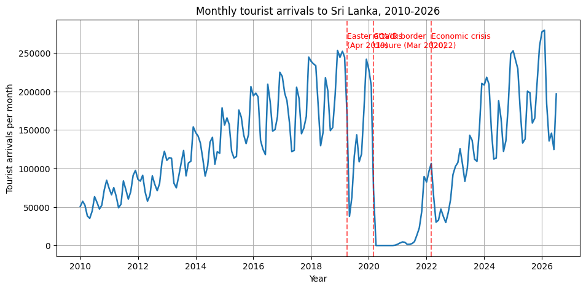
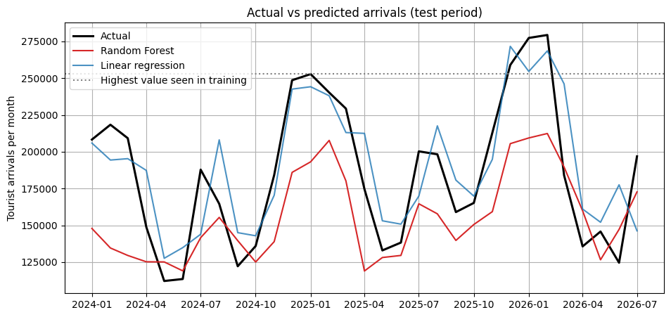
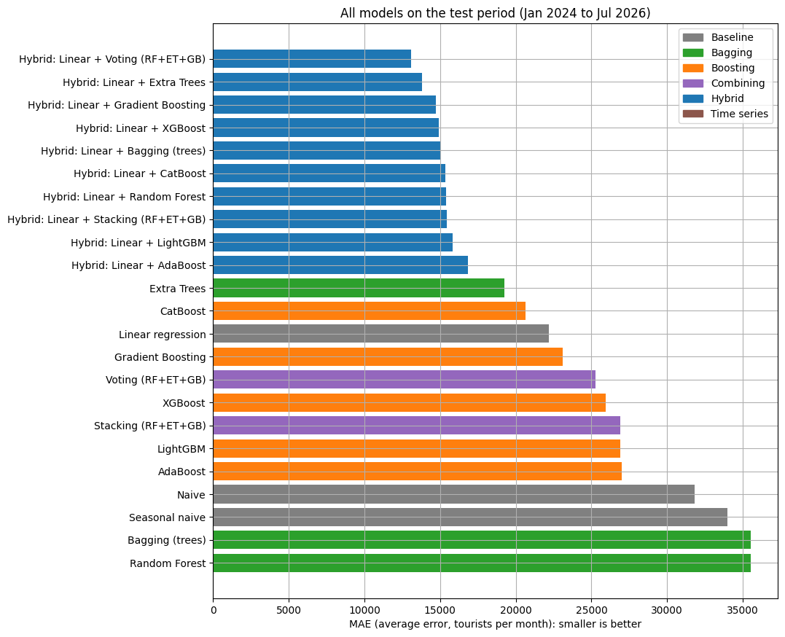
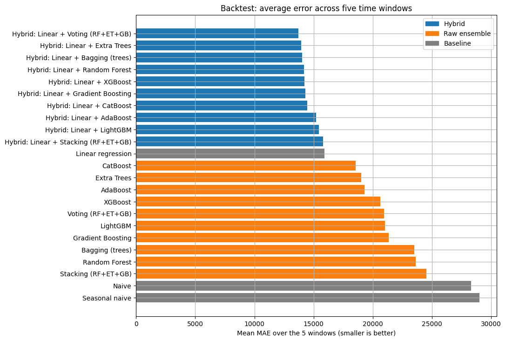
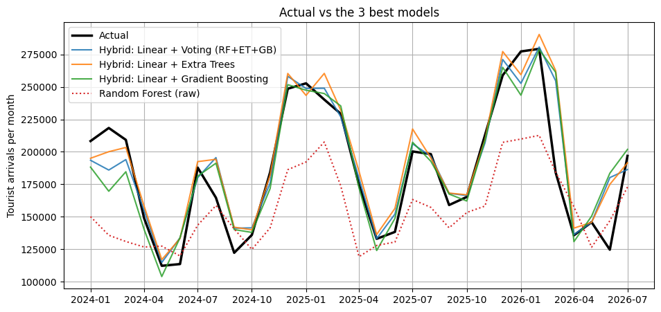

# Forecasting Monthly Tourist Arrivals in Sri Lanka with Ensemble Machine Learning

**Module / course:** Machine Learning & Pattern Recognition  
**Name:** R.D.H.M. Rambandara  
**Student ID:** 224159X

[](https://colab.research.google.com/github/RDHMRambandara/sri-lanka-tourism-ensemble/blob/main/notebooks/ensemble_tourism_forecasting.ipynb)

## Live dashboard
[Open the dashboard](https://sri-lanka-tourism-forecaster.streamlit.app)

## Video
[Watch the 3-minute project video](https://drive.google.com/file/d/1Spy33CsLnyWS1YMfwZSDcH92Ipk0g5Sv/view?usp=sharing)

*If the app is asleep, click "Yes, get this app back up!" and wait about a minute.*

## What this project does
It compares **bagging** (Random Forest, Extra Trees, Bagging), **boosting** (AdaBoost, Gradient Boosting, XGBoost, LightGBM, CatBoost) and **combining** methods (Voting, Stacking) for forecasting monthly tourist arrivals to Sri Lanka, using **month and monsoon-season** features. It then merges each ensemble with a **trend / time-series model** (hybrid models, including SARIMA) and explains **why** the models behave as they do (rolling backtest, feature tests, permutation importance, SHAP, error analysis).

**Data:** 199 months (Jan 2010 to Jul 2026) of tourist arrivals from the Sri Lanka Tourism Development Authority (SLTDA) and the USD/LKR exchange rate from the Central Bank of Sri Lanka. See [`data/DATA_SOURCES.md`](data/DATA_SOURCES.md).



## Main findings
(numbers come from one full run; they may differ slightly on another machine)

- A plain **Random Forest was worse than the naive baseline** on the 2024 to 2026 test (average error about 36,000 tourists per month). Tree ensembles average values seen in training, so they cannot reach record-high months or follow a rising trend.



- **Hybrid models** (a linear trend model plus an ensemble learning the leftovers) cut the error to about **13,000 to 17,000** per month. The best was *Linear + Voting* (about 13,100).



- A **five-window rolling backtest** confirmed it: all 10 hybrids had a lower average error than every raw ensemble. Linear regression or seasonal naive won some individual windows, so hybrids are best *on average* and most *reliable*, not best in every window.



- **SARIMA** must be compared fairly: forecast 31 months ahead it looked poor (error about 36,700), but one month ahead, like the machine learning models, it reached about 16,800. That beats every raw ensemble but is behind nine of the ten hybrids.
- **What drives the forecasts:** recent history (last month and the month before) first, then month and monsoon season. The **exchange rate adds very little**.
- The largest errors are **sudden drops** (for example March 2026) that past data cannot predict.



## Repository structure
```
data/        tourism_monthly_2010_2026.csv, DATA_SOURCES.md
notebooks/   ensemble_tourism_forecasting.ipynb   (main project, with outputs)
             02_ann_blends_stacking_final.ipynb   (ANN, blends, stacking, glass ceiling experiment)
dashboard/   app.py, forecast_lib.py, train_models.py   (Streamlit dashboard)
figures/     charts exported from the notebook
requirements.txt
```

## How to run
1. Click the **Open in Colab** badge above (or open the notebook in Colab).
2. Run all cells. If the `DATA_URL` in the data cell points to this repository, the data loads automatically; otherwise Colab asks you to upload `data/tourism_monthly_2010_2026.csv`.
3. Running takes a few minutes (the backtest trains about 200 models).

## Method in short
- **Split:** train Jan 2011 to Dec 2023, test Jan 2024 to Jul 2026 (time-ordered, no random split).
- **Features:** calendar, monsoon season, shock flag (Apr 2019 to Dec 2022), lags and rolling means (past data only, no leakage), lagged exchange rate.
- **Forecast type:** one month ahead.
- **Metrics:** MAE, RMSE, MAPE.

## Limitations
Small sample (199 months, 31 test months); one-month-ahead forecasts only; no hyperparameter tuning; few predictors; the hybrid idea was motivated by diagnostics on the test period (the backtest reduces this risk). Details are in the notebook.
